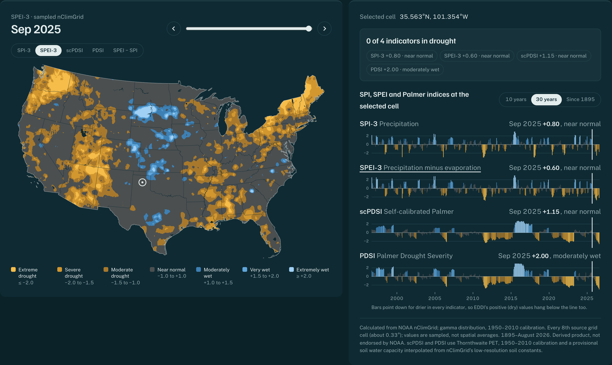

# climate_indices

[](https://pypi.org/project/climate-indices/)
[](https://github.com/monocongo/climate_indices/actions/workflows/unit-tests-workflow.yml)
[](https://climate-indices.readthedocs.io/en/latest/)
[](LICENSE)
[](#supported-python-versions)

**Reference implementations of climate indices for drought, wildfire, flood, and energy monitoring, for NumPy arrays and Dask-backed xarray grids.**



## What it does

`climate_indices` implements published climate index algorithms. Each one cites its source, and [`VALIDATION.md`](VALIDATION.md) records, index by index, what its results are checked against.
The code is a fork of work originally developed by NIDIS/NCEI/NOAA for drought monitoring. It now also covers wildfire (fire weather), flood potential, and the climate-driven part of energy supply and demand, plus power-system reliability and compound-hazard statistics.
Most functions accept NumPy arrays or `xarray.DataArray` input. The reliability indices take an interruption log instead. With Dask-backed `DataArray` input, most index routes stay lazy, so large grids can be written to NetCDF or Zarr chunk by chunk. A few routes compute eagerly, such as `energy.energy_drought_events()` on a one-dimensional series and the compound event catalogs. The [compatibility matrix](docs/xarray_compatibility.md) lists each route.
An optional compiled Rust backend runs the numerical kernels of many indices behind the same API. Without it, the Python implementation runs.
The library computes indices from data you supply, and index computation makes no network request. The optional `aws` extra fetches third-party soil rasters for available-water-capacity ingest; treat those tiles as untrusted input.

## Quickstart

```bash
pip install "climate-indices>=3.2.0"
# or
uv pip install "climate-indices>=3.2.0"
```

Compute a 3-month Standardized Precipitation Index (SPI) from 30 years of synthetic monthly precipitation:

```python
import numpy as np
import pandas as pd
import xarray as xr
from climate_indices import spi
from climate_indices.vocabulary import Distribution

time = pd.date_range("1990-01-01", periods=360, freq="MS")  # 30 years, monthly
precip = xr.DataArray(np.random.default_rng(42).gamma(2.0, 40.0, 360), coords={"time": time}, dims="time")
print(spi(precip, scale=3, distribution=Distribution.gamma)[-12:].values.round(2))
```

The script prints the last 12 monthly values:

```text
[-0.12  0.37  0.37  0.22 -1.02 -2.19 -0.49 -0.21  0.62 -0.49 -0.34 -0.9 ]
```

With a `DataArray`, the function reads the start year, the periodicity, and the calibration period from the `time` coordinate. The result is a `DataArray` on the same coordinates.
The first `scale - 1` values are missing because the 3-month window is not yet full. Values are standard-normal scores: negative means drier than the calibration period, and positive means wetter.
The library logs progress to stderr; see [logging](docs/troubleshooting.md#logging-and-debugging) to change the level.

With a plain NumPy array, the same function needs the time information stated explicitly. It returns the same values:

```python
import numpy as np
from climate_indices import spi
from climate_indices.vocabulary import Distribution, Periodicity

precip_mm = np.random.default_rng(42).gamma(2.0, 40.0, 360)  # 30 years of monthly values, from 1990
spi_3 = spi(
    precip_mm, scale=3, distribution=Distribution.gamma, data_start_year=1990,
    calibration_year_initial=1990, calibration_year_final=2019, periodicity=Periodicity.monthly,
)
```

For a longer walkthrough, open the [xarray getting-started notebook](notebooks/xarray_getting_started.ipynb) or read the [quickstart tutorial](docs/quickstart.md). To compute indices for many grid cells from NetCDF files, see the [command-line examples](docs/workflow-examples.md).

## Key features

- **NumPy and xarray APIs.** DataArray results keep coordinates and carry CF metadata. See the [compatibility matrix](docs/xarray_compatibility.md).
- **Gridded computation.** SPI, SPEI, EDDI, PNP, PET, and PDSI process a whole `(time, *cells)` block in one call. See [performance and chunking guidance](docs/performance.md).
- **NetCDF, Zarr, and Icechunk output.** See [writing outputs](docs/writing-outputs.md).
- **Fit diagnostics and event extraction.** `fit_diagnostics()` reports the fitted distribution parameters, and `climate_indices.runs` extracts events with duration, magnitude, and peak.
- **Optional Rust backend.** The same public API, checked against the Python implementation. See the [architecture notes](docs/architecture.md#optional-rust-backend) and the [benchmarks](benchmarks/README.md).
- **Evidence-classified results.** [`VALIDATION.md`](VALIDATION.md) separates external validation from regression-only coverage.
- **Command-line interface.** `climate_indices --index spi ...` computes indices from NetCDF files. See the [CLI reference](docs/reference.md#command-line-interface).

## Supported indices

Most indices are NumPy functions, and most of those also accept `DataArray` input. The reliability indices take an interruption log instead. Beta marks an interface that may still change; see [API stability](#api-stability).

| Category | Index | Description | Docs |
|:--|:--|:--|:--|
| Drought | SPI | Standardized Precipitation Index | [algorithms](docs/algorithms.md#standardized-precipitation-index-spi) |
| Drought | SPEI | Standardized Precipitation Evapotranspiration Index, from the precipitation minus PET balance | [algorithms](docs/algorithms.md#standardized-precipitation-evapotranspiration-index-spei) |
| Drought | SPAI (Beta) | Standardized Precipitation Anomaly Index, for strongly seasonal precipitation | [algorithms](docs/algorithms.md#standardized-precipitation-anomaly-index-spai) |
| Drought | Standardized index | The SPI fitting pipeline for any non-negative series, such as streamflow | [hydrologic indices](docs/standardized-hydrologic-indices.md) |
| Drought | PNP, PCI | Percentage of Normal Precipitation; Precipitation Concentration Index | [algorithms](docs/algorithms.md#additional-indices) |
| Drought | EDDI | Evaporative Demand Drought Index | [EDDI](docs/algorithm_refs/eddi.md) |
| Drought | Palmer | PDSI, PHDI, PMDI, Z-Index, and self-calibrating PDSI (scPDSI) | [Palmer](docs/algorithm_refs/palmer.md) |
| Evapotranspiration | PET | Potential evapotranspiration: Thornthwaite, Hargreaves-Samani, and FAO-56 Penman-Monteith (the last two estimate reference ETo) | [PET](docs/algorithm_refs/pet.md) |
| Wildfire | KBDI | Keetch-Byram Drought Index, a fuel-dryness index from daily precipitation and maximum temperature | [wildfire](docs/wildfire_applications.md) |
| Wildfire | CFFWIS | Canadian Forest Fire Weather Index System: FFMC, DMC, DC, ISI, BUI, FWI, DSR | [wildfire](docs/wildfire_applications.md) |
| Wildfire | FFWI, HDW, Haines | Fosberg Fire Weather Index, Hot-Dry-Windy Index, Haines Index | [wildfire](docs/wildfire_applications.md) |
| Flood potential | PE, EDI | Effective Precipitation and the Effective Drought Index (not EDDI) | [EDI](docs/algorithm_refs/edi.md) |
| Flood potential | Flood Index, API | Daily accumulated-wetness measures that indicate flood potential, not flooding; flood-event extraction | [flood index](docs/algorithm_refs/flood_index.md), [flood applications](docs/flood_applications.md) |
| Energy | Degree days, wind | Heating, cooling, and energy degree days; hub-height wind speed | [energy](docs/energy_applications.md) |
| Energy | Capacity factors | Wind and temperature-derated PV capacity factor (NumPy only) | [energy](docs/energy_applications.md) |
| Energy | SREPI, demand index, SRLI | Standardized energy production, demand, and residual-load indices; run-theory energy-drought events | [energy](docs/energy_applications.md) |
| Reliability | SAIFI, SAIDI, CAIDI, MAIFI, MAIFI_E, ASAI | IEEE Std 1366 distribution reliability indices from an interruption log | [reliability](docs/reliability_applications.md) |
| Compound | Compound hazards | Joint counts, likelihood multiplication factor, conditional probability, event matching, block bootstrap | [compound hazards](docs/compound-hazards.md) |

**Scope notes**

- Flood indices measure accumulated wetness that indicates flood potential. They do not model flooding.
- Energy indices describe the climate-driven part of supply and demand, not actual generation or load.
- Reliability indices (IEEE Std 1366) describe past service interruptions. They are not resilience metrics.
- Compound counts and probabilities describe co-occurrence. They make no causal claim. Block-bootstrap p-values are supported only within the scope that [`VALIDATION.md`](VALIDATION.md#compound-bootstrap-characterization) characterizes.
- Distribution choices, time-scale limits, and per-index validation caveats are in the linked docs and in [`VALIDATION.md`](VALIDATION.md).

## Installation

```bash
pip install "climate-indices>=3.2.0"          # into the current environment
uv pip install "climate-indices>=3.2.0"       # uv, into the current environment
uv add "climate-indices>=3.2.0"               # uv, as a dependency of a uv project
python -c "import climate_indices._native"  # succeeds when the Rust extension is installed
```

A missing Rust extension is not an error. `climate_indices` still imports, and every computation runs the Python implementation.

**Upgrading from 2.x?** 3.0.0 changes some computed values and exception types without a deprecation period. Each change, and how to detect it, is in [`docs/deprecations/api-changes.md`](docs/deprecations/api-changes.md).

### Supported Python versions

Supports Python **3.11–3.15**.

<details>
<summary>Installation details: Rust wheels, source builds, extras, and version history</summary>

**Version history.** 3.0.0 added the `fire`, `flood`, and `runs` modules and the optional Rust backend. 3.1.0 added the `compound` module and the `energy` family, promoted the DataArray index APIs to Stable, and added optional Icechunk I/O. 3.1.1 added Output Provenance and requires Python 3.11 or later. 3.2.0 added the `reliability` module, SPAI, and its pooled-anomaly fit. See the [CHANGELOG](CHANGELOG.md).

**Rust wheels.** Wheels for Linux (x86-64 and aarch64, manylinux_2_28, so glibc 2.28 or newer), macOS (Apple silicon and Intel), and Windows (x86-64) include the Rust backend. Every other platform, including a Linux system with older glibc, installs the pure-Python wheel. Both carry the same version and the same public API. Results agree within the [cross-backend parity tolerance](docs/architecture.md#parity-tolerance), not necessarily bit for bit.

**Source builds.** `pip install --no-binary climate_indices climate_indices` installs from the sdist, which builds the pure-Python wheel and needs no Rust toolchain. To build the extension from a checkout, run `uv run maturin develop --release`; see the [Rust backend notes](docs/architecture.md#optional-rust-backend).

**Icechunk.** The optional `icechunk` extra adds Icechunk-backed reads and writes. Releases up to and including 3.2.0 pin `icechunk>=1.1.21,<2`: `pip install "climate_indices[icechunk]>=3.1.0"`. The `icechunk>=2.2,<3` extra needs Python 3.12 or later and is not yet on PyPI. Until a release publishes it, install from a checkout with `pip install ".[icechunk]"`. See [writing outputs](docs/writing-outputs.md#read-and-write-icechunk-snapshots) and the [Icechunk notebook](notebooks/icechunk_spi_spei.ipynb).

**Other extras.** `earthengine` adds the `xee` and `earthengine-api` packages that some notebooks use, and `aws` adds the raster dependencies for available-water-capacity ingest. See [Earth Engine and Climate Engine](docs/earthengine-climate-engine.md).

</details>

## Documentation

The full documentation is on [Read the Docs](https://climate-indices.readthedocs.io/en/latest/).

**Learn**
- [Quickstart tutorial](docs/quickstart.md) and [tutorials](docs/tutorials.md)
- [Data requirements](docs/data_requirements.md): the inputs and units each index expects
- [Choosing parameters](docs/choosing-parameters.md) and [checking distribution fit](docs/checking-distribution-fit.md)
- [Troubleshooting](docs/troubleshooting.md)

**Notebooks** (in [`notebooks/`](notebooks/))
- [SPI with xarray](notebooks/xarray_getting_started.ipynb), [Zarr and Dask](notebooks/zarr_dask_spi_spei.ipynb), [Icechunk](notebooks/icechunk_spi_spei.ipynb)
- [Palmer indices](notebooks/palmer_indices_xarray.ipynb) and [EDDI](notebooks/eddi_xarray.ipynb)
- [Fire weather](notebooks/fire_weather_demo.ipynb), [flood event](notebooks/flood_event_brisbane_2011.ipynb), [energy](notebooks/energy_demo.ipynb), and [reliability](notebooks/reliability_demo.ipynb)

**Reference and project**
- [API and CLI reference](docs/reference.md) and [algorithm descriptions](docs/algorithms.md)
- [Validation status](VALIDATION.md), [benchmarks](benchmarks/README.md), and [architecture decision records](docs/adr/index.md)
- [Changelog](CHANGELOG.md)
- [Rust crate](crates/climate-indices/README.md): the numerical kernels as a standalone crate on [crates.io](https://crates.io/crates/climate-indices)
- [License](LICENSE), [disclaimer](DISCLAIMER), and [citation metadata](CITATION.cff)

## API stability

The NumPy index functions and the xarray index functions that accept a `DataArray` are **Stable**, except the Beta routes below. Stable routes follow semantic versioning, with no breaking changes in minor releases. The Beta routes are the compound Dataset routes, the eager compound event catalogs, SPAI (NumPy and `DataArray`), and `energy.energy_drought_events()` with `DataArray` input. Their interfaces may change in minor releases but not in patch releases, and most of them emit `BetaFeatureWarning`. See the [compatibility matrix](docs/xarray_compatibility.md).

## Contributing

Contributions are welcome. [`CONTRIBUTING.md`](CONTRIBUTING.md) describes the workflow, the scientific standards for new indices, and the checks a pull request must pass. [`docs/development-guide.md`](docs/development-guide.md) covers the local setup.
To report a bug or suggest an index, [open an issue](https://github.com/monocongo/climate_indices/issues).

## Citation
You can cite `climate_indices` in your projects and research papers via the BibTeX 
entry below.
```
@misc {climate_indices,
    author = "James Adams",
    title  = "climate_indices, an open source Python library providing reference implementations of commonly used climate indices",
    url    = "https://github.com/monocongo/climate_indices",
    month  = "may",
    year   = "2017--"
}
```

## License and disclaimer

Released under the [BSD 3-Clause license](LICENSE), with some third-party components under their own terms; see [licensing](docs/licensing.md). This repository is a scientific product and is not official communication of NOAA or the U.S. Department of Commerce; read the full [disclaimer](DISCLAIMER). The code originated at NIDIS/NCEI/NOAA; see [drought.gov](https://www.drought.gov/data-maps-tools/climate-and-drought-indices-python-spi-spei-pet).
